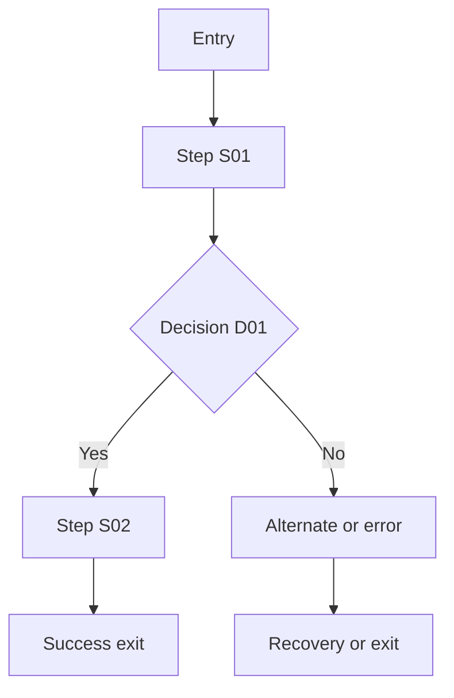

# User Flow — [Task Name]

**Designer instructions:** Duplicate this file for each distinct user task. Replace placeholders with project-specific, approved behavior. Keep step IDs stable and update whenever the design changes. Do not invent unconfirmed requirements.

## 1. Overview
| Attribute | Designer input |
|---|---|
| Feature ID / flow ID | `[FEAT-001 / FLOW-001]` |
| Goal / success metric | `[USER GOAL AND OBSERVABLE RESULT]` |
| Primary user / role | `[ROLE]` |
| Other actors | `[ROLES OR N/A]` |
| Entry points | `[SCREEN IDS, LINKS, DEEP LINKS]` |
| Preconditions | `[AUTH, ROLE, DATA, STATUS]` |
| Success exit / destination | `[END STATE AND SCREEN ID]` |
| Design / prototype | `[LINK]` |
| FRD / functional memory | `[LINKS]` |
| Flow diagram | `[LINK]` |

## 2. Scope
**Included:** `[TASK BOUNDARIES]`  
**Excluded:** `[RELATED FLOWS DOCUMENTED ELSEWHERE]`

## 3. Main path
| Step ID | Screen ID | Actor | Action / trigger | System response / feedback | Data or state change | Next |
|---|---|---|---|---|---|---|
| S01 | `[SCR-001]` | `[ROLE]` | `[ACTION]` | `[RESULT]` | `[CHANGE / NONE]` | `S02` |
| S02 | `[SCR-002]` | `[ROLE]` | `[ACTION]` | `[RESULT]` | `[CHANGE / NONE]` | `[EXIT / STEP]` |

## 4. Decisions and branches
| Decision ID | At step | Exact condition | Yes / allowed | No / denied | Source / status |
|---|---|---|---|---|---|
| D01 | `[S02]` | `[RULE]` | `[NEXT STEP]` | `[NEXT STEP]` | `[LINK / CONFIRMED OR TBD]` |

## 5. Alternate paths
| Path ID | From step | Trigger | Alternate steps | Rejoin / exit |
|---|---|---|---|---|
| ALT-01 | `[S02]` | `[BACK / CANCEL / EDIT / OTHER]` | `[STEPS]` | `[DESTINATION]` |

## 6. Errors and recovery
| Error ID | Step | Cause | Visible state / approved copy | Recovery | Retained / reset data |
|---|---|---|---|---|---|
| ERR-01 | `[S02]` | `[VALIDATION / NETWORK / PERMISSION]` | `[UI / COPY TBD]` | `[ACTION]` | `[RULE]` |

## 7. Permissions
| Role | Entry allowed? | Available actions | Restricted actions | Denied outcome |
|---|---|---|---|---|
| `[ROLE]` | `[YES/NO/CONDITIONAL]` | `[ACTIONS]` | `[ACTIONS]` | `[OUTCOME]` |

## 8. End states
| Exit | Condition | Destination | Persistence / notifications |
|---|---|---|---|
| Success | `[CONDITION]` | `[SCREEN]` | `[RESULT]` |
| Cancel | `[CONDITION]` | `[SCREEN]` | `[RESULT]` |
| Failure | `[CONDITION]` | `[SCREEN]` | `[RESULT]` |

## 9. Diagram
**Diagram link:** `[FIGMA / MIRO / OTHER]`

## 10. Open questions
| ID | Missing rule | Impact | Owner | Resolution/status |
|---|---|---|---|---|
| Q01 | `[QUESTION]` | `[IMPACT]` | `[OWNER]` | `Open` |

## Designer review
- [ ] One task/goal per flow; entry and exit defined.
- [ ] Every step specifies user action, system response, and next step.
- [ ] Every decision has all possible outcomes.
- [ ] Alternate, cancellation, failure, and retry paths covered.
- [ ] Permissions, state changes, and re-entry behavior captured.
- [ ] Diagram matches steps and current design.
- [ ] Flow references FRD, screens, and functional memory.
- [ ] Unknown requirements explicitly marked TBD.

## Change history
| Date | Version | Changed steps | Reason / approval |
|---|---|---|---|
| `[DATE]` | `[VERSION]` | `[DETAILS]` | `[SOURCE]` |
